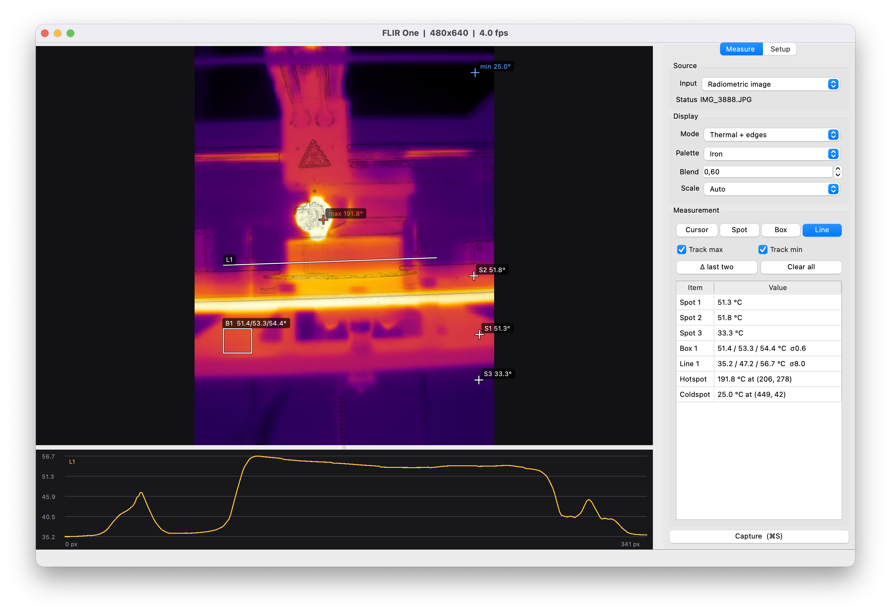
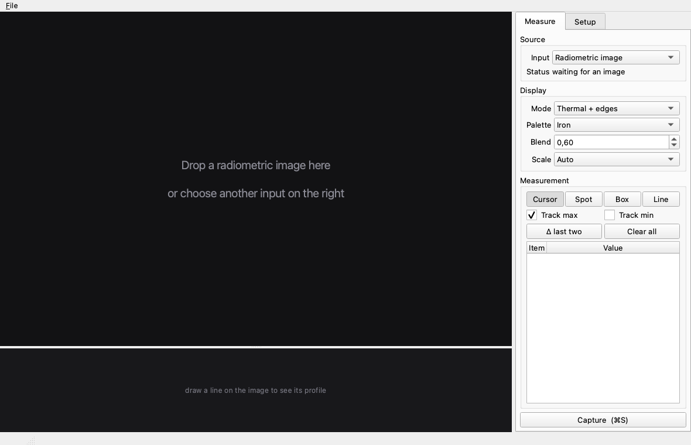
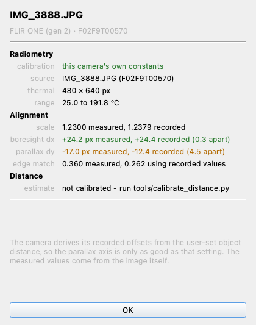
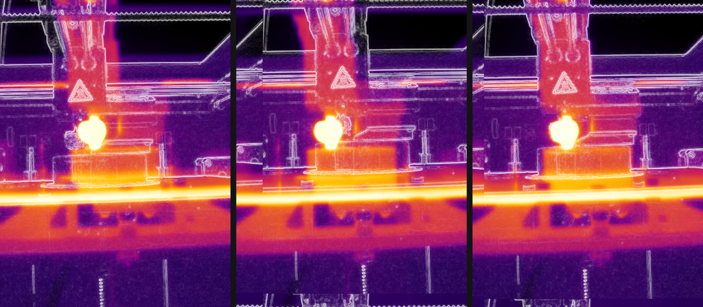
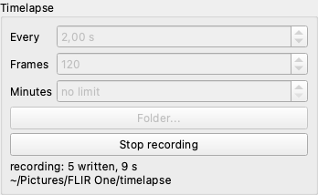

# flirone-mac

Viewer and radiometric measurement tool for the FLIR One thermal camera, on
macOS and Linux.

Live dual-mode preview (thermal + visible), spot/box/line measurements with
emissivity and atmospheric correction, and captures that can be reprocessed
later.



Spot, box and line measurements over a radiometric image, with the line profile
plotted beneath and every reading in absolute degrees. Conditions, alignment and
calibration live on the Setup tab.

## Status

1.0.0 works on macOS and Linux, live and from a file, in absolute degrees. Both
were verified against the camera rather than inferred. Linux streams slower,
about 5.3 fps against 8.0, which is measured and unexplained.

**Switch the camera on.** The FLIR One has its own power button. With it off it
still enumerates and still completes the handshake, and simply never sends a
frame; the application now says so after six seconds instead of waiting.

**Live streaming** from a Lightning FLIR One runs at about 8 fps on macOS and
5.3 on Linux, recovers from a disconnect on its own in around half a minute, and
reads absolute temperatures with no per-camera calibration beyond loading the
constants once.

**Radiometric images from the phone app** carry the camera's own constants and
the conditions of the shot, so every measurement tool runs properly calibrated.

**The Android/USB-C variant** speaks the documented vendor protocol with no iAP
layer. That path is in the code and untested: the only camera here is a
Lightning unit, which never reaches it.

How the camera was made to talk, and what was measured to make its numbers mean
something, is in [docs/hardware-findings.md](docs/hardware-findings.md).

## Install

### macOS

```bash
brew install exiftool libusb
uv venv --python 3.12
uv pip install -e .
```

Two external tools are needed, for different halves of the application:

- **exiftool** reads FLIR's APP1 metadata: the camera's calibration, the
  conditions of the shot and the raw thermal plane. Without it, radiometric
  images cannot be opened at all. It is the only reliable reader for that
  layout, which is why it is shelled out to rather than reimplemented.
- **libusb** drives the camera over USB. Without it, files still work and only
  live capture is unavailable.

Both are located by absolute path rather than through `PATH`, so they are still
found from an app bundle launched by Finder, which inherits no shell
environment. 

### Linux

Live streaming is verified on Linux against the camera, on Ubuntu 22.04 with
kernel 5.15. It runs about 5.3 fps there against 8.0 on macOS; the cause is not
known and is recorded rather than explained. Everything else matches, recovery
from a pulled cable included. The two host settings below are what makes the
camera enumerate at all.

```bash
sudo apt install libimage-exiftool-perl libusb-1.0-0
uv sync
```

Two host settings are needed before the camera will enumerate at all.

**Switch USB enumeration to the old scheme.** Under Linux's default the camera
answers the first descriptor request and then leaves the bus during the second
port reset, so it never receives an address and re-attaches about once a second
forever:

```bash
echo 1 | sudo tee /sys/module/usbcore/parameters/old_scheme_first
```

Make it permanent by adding `usbcore.old_scheme_first=1` to
`GRUB_CMDLINE_LINUX_DEFAULT` in `/etc/default/grub`, then `sudo update-grub`.
The setting is global and safe to carry: it was the kernel's own default
historically, and `use_both_schemes` keeps the new scheme as a fallback.

**Add a udev rule**, or pyusb can only claim the camera as root:

```bash
sudo tee /etc/udev/rules.d/99-flirone.rules >/dev/null <<'EOF'
SUBSYSTEM=="usb", ATTR{idVendor}=="09cb", MODE="0660", GROUP="plugdev", TAG+="uaccess"
EOF
sudo udevadm control --reload-rules
sudo udevadm trigger --subsystem-match=usb
```

Your user has to be in `plugdev`. `ATTR{idVendor}` is lowercase hex with no
`0x`; `0x09CB` matches nothing and fails silently.

Section 12 of [docs/hardware-findings.md](docs/hardware-findings.md) has the
usbmon trace behind both.

## Run

```bash
uv run flirone
```



It opens waiting for an image. Drop one on the window, on the Dock icon, or pass
it on the command line.

### macOS

Or build a double-clickable bundle, with a nice-looking icon:

```bash
./packaging/make_app.sh
```

### Linux

`uv run flirone` is enough. There is no dedicated build for Linux yet.

Qt ships its own platform plugins inside the venv, so nothing is needed beyond
the two packages above.

## Calibration

The camera streams sensor counts, not temperatures. Converting them needs the
Planck constants, which are **per unit** and are not carried in the USB stream.
Until you load them the app runs with a reference camera's constants, marks
itself UNCALIBRATED, and shows readings in orange: those are usable for relative
thermography and must not be quoted as absolute temperatures.

That is the only calibration there is. The live stream sits four times below the
plane those constants describe, but four is a bit depth rather than a property
of your unit, so it is a constant in the code and there is nothing to measure.

To calibrate, shoot one image with the FLIR One phone app and load it via
*File > Load calibration from radiometric JPEG*. The constants are read straight
out of the FLIR APP1 segment (exiftool is used as a fallback).

Calibrating is a one-off. The constants are remembered per camera, filed under
its serial, so a camera that has been calibrated once is calibrated every time:
plug it in and readings are absolute from the first frame. Two cameras are kept
apart, each only ever matched with its own constants, and constants carrying no
serial are not remembered at all. *File > Forget this camera's calibration* and
*File > Forget all stored calibrations* drop what is stored and return readings
to relative. The store lives in `~/Library/Application Support/flirone` on macOS
and `~/.config/flirone` on Linux.

## Radiometric images

Open a JPEG shot with the FLIR One phone app by dropping it on the window,
dropping it on the Dock icon, passing it on the command line, or `File > Open
radiometric image` (Ctrl+O, ⌘O on macOS). These carry the camera's own
calibration, so they read absolute with nothing loaded first.
Emissivity, reflected apparent temperature, humidity and distance are read from
the file and can then be adjusted, and the whole field is recomputed.

Auto scaling clips to the 1st-99th percentile. A few saturated pixels otherwise
consume most of the palette and flatten the scene; "Full range" gives true
min/max if you want it.

Drops also accept a saved calibration (`.json`) and a folder of captures, which
starts replaying it. Dropping a calibration together with an image applies the
calibration first.

## Alignment

The visible and thermal cameras sit a few millimetres apart, so the visible
image must be scaled and shifted onto the thermal one.

Radiometric JPEGs record the alignment the camera used (`Real2IR`, `OffsetX`,
`OffsetY`). Those offsets are in **visible-image pixels** and signed opposite to
this code's convention, so they need dividing by the visible-to-thermal grid
ratio and negating. Read correctly they are good, and the app applies them the
moment an image is opened.

They are not the whole story, though. The camera derives them from the
**user-set object distance**, usually left at its 1 m default. Parallax appears
on the horizontal axis, so:

- `dx` carries the parallax, so it is only as good as that distance setting
- `dy` is the fixed boresight offset and does not depend on distance

Which axis carries the parallax was established by measurement, not assumption:
the published optics (160x120 over 46 x 35 degrees) turn a fitted offset-versus-
distance slope into a lens separation, and only the horizontal axis gives one
near the 9 to 11 mm the camera actually has. The vertical axis implied 103
degrees of field, which is impossible.

`Auto-align from edges` measures both from the image. The two images share
almost no intensity relationship but do share structure, so registration runs on
gradient magnitude: phase correlation for translation, swept over scale,
selected by normalised cross-correlation. It runs automatically on import and
the result is reported on a summary card.



The card sets what the file recorded against what was measured from it, so
the two can be compared rather than silently merged.



Left: no offset. Middle: the offsets the camera recorded. Right: recovered from
edges. Watch the warning triangle and the glowing blob, where only the right
panel puts the visible edges on the thermal features.

Measured on a FLIR One Gen 2 frame:

| quantity | recorded | measured | agreement |
|---|---|---|---|
| scale | 1.2379 | 1.2300 | 0.6% |
| `dx` (parallax) | +24.44 px | +24.15 px | 0.29 px |
| `dy` (boresight) | −12.44 px | −16.99 px | 4.54 px |

Edge cross-correlation improves from 0.262 using the recorded values to 0.360
using the measured ones, so measuring the alignment beats trusting the recorded
one whenever the object distance was left at its default.

### Spot size

A radiometric reading is only trustworthy when the target fills several detector
elements. Below three the pixel averages target and surroundings and the reading
is pulled toward the background, which is the commonest way to get a confidently
wrong temperature.

The cursor readout warns when the feature under it is too small, judged on the
**detector** grid: files from the phone app arrive upscaled 4x, which adds no
information, so a target that looks 12 px wide in the file is 3 px on the sensor.

With one detector pixel subtending 5.05 mrad (160x120 over 46 x 35 degrees):

| distance | one pixel | minimum target (3 px) | comfortable (10 px) |
|---|---|---|---|
| 0.3 m | 1.5 mm | 5 mm | 15 mm |
| 0.5 m | 2.5 mm | 8 mm | 25 mm |
| 1 m | 5.1 mm | 15 mm | 51 mm |
| 2 m | 10.1 mm | 30 mm | 101 mm |

The check needs no calibration; it works on the image alone. Setting the
distance in Conditions additionally expresses the size in millimetres.

## Measurement tools

- Spots, boxes and line profiles, with min/max/mean/median/stddev
- Auto-tracked hottest and coldest pixel
- Delta between any two spots, the usual way a thermal fault is called
- Emissivity, reflected apparent temperature, air temperature, humidity and
  distance, applied through the full FLIR object-radiance correction
- Isotherm masking

Left-click places or drags, right-click removes.

Scroll to zoom, up to 16x, anchored on the pointer so the feature under it stays
put. In Cursor mode a left-drag pans, so no middle button is needed. At
fit-to-window the image is drawn at roughly its own size, which is too small to
judge an alignment to the pixel.

Blend and the three alignment values are sliders with the value beside them. On
the two offset sliders a click beside the handle steps one pixel rather than
jumping to where it landed, so a stray click does not discard a careful
alignment; the arrow keys step by one as well.

## Captures

A capture stores everything needed to reconstruct the measurement later: raw
counts, the temperature field, the visible photograph, the rendered image, and
the calibration and conditions in force.

Line profiles are written as CSV alongside, one file per line, and can also be
exported on their own with `File > Export line profile as CSV` (Ctrl+E, ⌘E on
macOS):

```
# flirone line profile bed
# from,(0,384),to,(479,384),samples,480
# calibration,camera,source,IMG_3888.JPG (F02F9T00570)
# emissivity,0.95,reflected_c,22.0,atmospheric_c,20.0,humidity,0.5,distance_m,1.0
index,distance_px,x_px,y_px,temperature_c
0,0.000,0,384,53.730
1,1.000,1,384,53.681
```

Pixel coordinates come with every row, so a sample can be traced back to the
image. The commented header carries the calibration and conditions, because a
column of degrees separated from its provenance cannot be checked or recomputed.
Read it with `pandas.read_csv(path, comment="#")`.

Hovering the image reports the pixel under the cursor; hovering the profile plot
marks the corresponding pixel on the image and names the CSV row, which is how a
feature on the curve gets tied to a place in the scene.

## Timelapse

It is possible to record multiple frames at periodic intervals. `Setup > Timelapse` takes an interval, an optional frame count, an optional length in minutes, and a folder, and writes
one radiometric JPEG per tick.



The controls lock while a run is going and the line underneath counts what has
been written, what was skipped, and where it is going.

The files are the same kind the phone app writes, so they open here with every
measurement tool and in FLIR's own software, and a whole run can be reprocessed
later under corrected emissivity or distance. A frame from this camera is about
140 kB against the 1.4 MB the phone app produces, the difference being a
1080x1440 visible image there is no reason to reproduce.

Three things stop a run before it starts. A camera has to be streaming, since
an image opened from a file is already saved. The calibration in use must have
come from that camera, because hundreds of files claiming absolute temperatures
are worth nothing if they carry another unit's constants. And one radiometric
image from it must have been opened at least once, since the files written are
built from the structure of one it made itself. In practice that is the same
image the calibration came from.

Files are numbered by tick, not by file. A tick that finds no new frame writes
nothing and spends its number, so a stalled camera or a pulled cable leaves a
hole in the sequence:

```
flirone-000001.jpg
flirone-000002.jpg
flirone-000005.jpg    <- the camera was away for two ticks
flirone-000006.jpg
```

From a terminal, with no window:

```bash
uv run flirone-timelapse ~/Pictures/run --every 2 --frames 120
uv run flirone-timelapse ~/Pictures/run --every 1 --minutes 30 --emissivity 0.92
```

The measurement conditions are the same five the window offers: `--emissivity`,
`--reflected`, `--air`, `--humidity`, `--distance`, defaulting to what the window
starts with and recorded in every file. A value outside its range is clamped and
said so, since a mistyped emissivity would otherwise be written into hundreds of
files as though it had been chosen.

It records whichever camera it finds and reads the serial from the handshake, so
the constants and the container come from the store without being named. On a
machine that has never seen this camera, file them first, which needs no window:

```bash
uv run flirone-timelapse --calibrate IMG_9400.JPG
uv run flirone-timelapse --calibrate IMG_9400.JPG ~/Pictures/run --every 2
```

Given a folder as well, the image is checked against the camera that is
streaming, so one from a different unit stops the run there rather than hours
in. On its own there is no camera to check against and it says so.

`--frames 0` and `--minutes 0` mean no limit, for a run left going. The
same three refusals apply and exit non-zero. Ctrl-C ends the run and still
prints the summary:

```
Bringing the camera up.
Recording F02F9T00570 to ~/Pictures/run
  1 written, 2 s
  2 written, 3 s
^C
12 written, 0 skipped, 0 late in 14 s
in ~/Pictures/run
```

Nothing on this path imports Qt, so it runs over ssh and on a machine with no
display.

From a script, if the library is wanted directly:

```python
from pathlib import Path
from flirone import timelapse
from flirone.calibration import Conditions
from flirone.calibration_store import CalibrationStore
from flirone.sources import UsbFrameSource

source = UsbFrameSource()
source.start()
store = CalibrationStore()
serial = "F02F9T00570"

timelapse.record(
    source,
    timelapse.Settings(Path("~/Pictures/run").expanduser(), interval_s=2.0, max_frames=120),
    store.find(serial),
    Conditions(emissivity=0.95, distance_m=1.5),
    store.template(serial),
    camera_serial=serial,
)
```

## Diagnostics

```bash
uv run flirone-probe           # descriptor tree, read-only
uv run flirone-probe --open    # also set the configuration and claim the interfaces
```

An idle camera re-enumerates every few seconds, so the probe polls rather than
looking once; `--wait` sets for how long.

The scripts in `research/iap2-probes/` are the evidence behind
[docs/hardware-findings.md](docs/hardware-findings.md). They are unmaintained,
excluded from lint and not part of the package.

## Credit

The frame format and init sequence come from the EEVblog thermal-imaging
community's reverse engineering, via
[fnoop/flirone-v4l2](https://github.com/fnoop/flirone-v4l2) (GPL-2.0).
